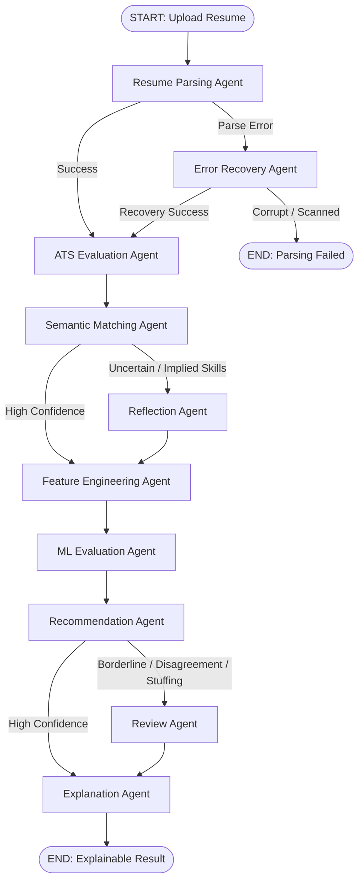

# AI-Based Resume Screening and Candidate Evaluation System

An academic, production-quality recruitment decision support system combining **Traditional ATS**, **Local Transformer Embeddings (BAAI/bge-small-en-v1.5)**, **FAISS Vector Search**, **Scikit-Learn Machine Learning (LR / RF / KNN)**, **Google Gemini GenAI**, and **LangGraph Multi-Agent Orchestration**.

Developed for MCA / Computer Science college academic demonstration and viva defense.

---

## 1. Core Philosophy & Design Principles

> **"How well does this candidate fit THIS specific job?"**

1. **No universally "best resume":** A resume is evaluated strictly relative to a specific Job Description.
2. **Transparent Mathematical Scoring (No Arbitrary LLM Scores):** The LLM does **NOT** decide *"This candidate is 87/100"*. Numerical scores are computed from 8 measurable feature dimensions using a transparent weighted formula.
3. **Evidence-Based Grounding:** Every match (or missing skill) is backed by quoted evidence passages retrieved from resume experience/projects via FAISS vector search.
4. **Keyword Stuffing Detection:** Repetitive keyword frequency is compared against actual project/experience evidence. Repeated terms with 0% evidence are flagged for human review.
5. **Fairness Safeguards:** Sensitive demographic attributes (gender, age, marital status, caste, religion, photograph) are detected and stripped before feature engineering or scoring.

---

## 2. System Architecture

```text
                     RECRUITER
                         │
                         ▼
                 FRONTEND DASHBOARD (Next.js 16 + Tailwind CSS)
                         │
                         ▼
                     FASTAPI REST API (Python 3.11)
                         │
                         ▼
             LANGGRAPH MULTI-AGENT ORCHESTRATOR
                         │
        ┌────────────────┼────────────────┐
        ▼                ▼                ▼
 Resume Parser       JD Analyzer       ATS Agent
        │                │                │
        └────────────────┼────────────────┘
                         ▼
              Semantic Matching Agent
                         │
              ┌──────────┴──────────┐
              ▼                     ▼
       BGE-small Embeddings    Feature Engine (8 Dims)
              │                     │
              ▼                     ▼
         FAISS Index         Scikit-Learn Models
              │               (LR / RF / KNN)
              └──────────┬──────────┘
                         ▼
                  Reflection Agent (Implied Skills: Django -> Python)
                         │
                         ▼
                  ML Evaluation Agent (Second Opinion)
                         │
                         ▼
                  Review Agent (Borderline / Stuffing / Disagreement)
                         │
                         ▼
                 Recommendation Agent (Shortlist / Review / Weak)
                         │
                         ▼
                 Explanation Agent (Gemini GenAI / Grounded Template)
                         │
                         ▼
                 EXPLAINABLE REPORT & RANKING
```

---

## 3. Technology Stack

| Layer | Technologies Used | Reason Selected |
|---|---|---|
| **Frontend** | Next.js 16 (App Router), TypeScript, Tailwind CSS, Recharts, Mermaid | Responsive recruiter dashboard with live state graphs and charts |
| **Backend** | Python 3.11, FastAPI, Pydantic v2, SQLAlchemy | High-performance asynchronous REST API with strict typed contracts |
| **Document Parsing** | PyMuPDF (`fitz`), `python-docx` | Robust text and table extraction with alternate block-reconstruction recovery |
| **Embeddings** | `BAAI/bge-small-en-v1.5` (Sentence-Transformers) | Fast local inference (384-dim), zero API cost, high retrieval quality |
| **Vector Database** | FAISS (`faiss-cpu`, `IndexFlatIP`) | Real-time exact inner product cosine search on L2-normalized passages |
| **Machine Learning** | Scikit-Learn (`LogisticRegression`, `RandomForest`, `KNN`) | Transparent comparative empirical evaluation with cross-validation |
| **GenAI / LLM** | Google Gemini 2.5 Flash (`google-genai` SDK) | Grounded structured explanations with deterministic template fallback |
| **Orchestration** | LangGraph (`StateGraph`, conditional edges) | Typed state transitions, reflection loops, and error recovery agents |
| **Tool Protocol** | Model Context Protocol (MCP v2) | Standardized tool server (`app/mcp_server.py`) for external tool use |
| **Database** | SQLite | Persistent long-term memory (jobs, candidates) and episodic memory |

---

## 4. Transparent Scoring Framework

The candidate fit score is calculated using this centralized formula (weights sum to 1.0):

$$\text{Overall Score} = 0.30 \times \text{ReqSkill} + 0.20 \times \text{Exp} + 0.15 \times \text{Semantic} + 0.10 \times \text{Proj} + 0.10 \times \text{ATS} + 0.10 \times \text{Edu} + 0.05 \times \text{Quality}$$

```text
Required Technical Skill Match    30%   (Sum of evidence credits for required skills)
Experience Relevance              20%   (Years of industry experience vs required min)
Semantic Vector Similarity        15%   (FAISS cosine similarity calibrated to 0-1)
Project Relevance                 10%   (Technical overlap in project entries)
ATS Compatibility                 10%   (Contact info, sections, formatting quality)
Education & CS Degree Match       10%   (Degree level: Diploma/Bachelor/Master + CS field)
Resume Formatting Quality          5%   (Word count balance, table density, headings)
--------------------------------------
TOTAL                             100%
```

### Recommendation Bands

- **85 – 100:** Strong Match (`STRONG_SHORTLIST`)
- **70 – 84:** Match (`SHORTLIST`)
- **55 – 69:** Needs Review (`REVIEW`)
- **0 – 54:** Weak Match (`WEAK_MATCH`)
- *Borderline Margin (±3 pts):* Automatically flagged for human recruiter audit.

---

## 5. Controlled Test Cases: Why Semantic AI Beats Traditional ATS

| Case | Scenario | Traditional Keyword ATS | Our AI Semantic System | Viva Significance |
|---|---|---|---|---|
| **Case A** | Exact keyword match (React & Node.js) | ✓ Found (100% score) | ✓ `MATCH` (Confidence: 0.92) | Both systems succeed on direct keyword resumes. |
| **Case B** | Semantic match ("Built RESTful backend web services using Express and JS") | ✗ **MISSING (0 pts)** | ✓ `SEMANTIC_MATCH` (Sim: 0.78, Credit: 85%) | **Core Viva Demo:** Keyword ATS rejects strong candidate; Semantic AI recognizes Express as Node.js backend. |
| **Case C** | Keyword Stuffing (Repeats React, Node.js 10x with only sales experience) | ✓ **Top Rank (Keyword density)** | ⚠ `CLAIMED_ONLY` (Stuffing Flagged -> Review) | Keyword ATS is easily tricked; AI compares keyword frequency against evidence. |
| **Case D** | Implied Experience (Django web framework in resume; JD requires Python) | ✗ **MISSING (0 pts)** | 🔄 `INFERRED` via Reflection Agent (Credit: 50%) | Reflection Agent uses skill implication graph to infer knowledge and flag for check. |

---

## 6. Multi-Agent State Graph



---

## 7. Machine Learning & Dataset Benchmarks

The system features dual scientific benchmarks:
1. **Real Sample Resume Dataset ($N=66$ pairs across 11 candidates and 6 roles):** Evaluated with Grouped Stratified Split (`StratifiedGroupKFold`) by candidate ID to completely eliminate data leakage between train and test sets.
2. **Synthetic Benchmark ($N=800$ candidates):** Maintained for statistical power and sample-size validation.

Both benchmarks train and compare 3 classification algorithms:
1. **Logistic Regression (Interpretable Baseline):** Linear decision boundary with transparent coefficients.
2. **Random Forest (Ensemble Non-Linear):** 100 decision trees with Gini impurity feature importances.
3. **K-Nearest Neighbors (Instance-Based):** Distance metric ($k=5$ or $7$) with permutation importance.

### Empirical Benchmark Summary:

| Benchmark | Selected Model | Test Accuracy | Macro Precision | Macro Recall | Macro F1 | Shortlist Recall | Leakage Prevention |
|:---|:---|:---:|:---:|:---:|:---:|:---:|:---|
| **Real Resumes (N=66 pairs)** | **Logistic Regression** | **88.9%** | **91.5%** | **84.1%** | **86.6%** | **100.0%** | **Grouped Split (Zero Leakage)** |
| **Synthetic (N=800)** | **Logistic Regression** | **86.2%** | **84.0%** | **81.0%** | **82.1%** | **67.3%** | Stratified 80/20 |

*Academic Integrity Notice:* Real sample pairs use deterministic `label_source = "RULE_BASED"`. Zero fabricated human labels are claimed unless verified in `data/labels/human_labels.csv`.

---

## 7b. Objective Resume Quality vs Candidate-Job Fit (Core Viva Thesis)

```text
┌─────────────────────────────────────────────────────────────┐
│                 TWO DISTINCT EVALUATION AXES                │
├───────────────────────────────┬─────────────────────────────┤
│ 1. Resume Quality (0-100)     │ 2. Candidate-Job Fit (0-100)│
├───────────────────────────────┼─────────────────────────────┤
│ • Objective document quality  │ • Job-specific relevance    │
│ • Independent of any Job      │ • Evaluated against 1 JD    │
│ • 6 Dimensions: Completeness, │ • 7 Weighted Factors:       │
│   ATS Readability, Structure, │   30% Required Skills       │
│   Action Verbs, Metrics,      │   20% Experience Relevance  │
│   Formatting Consistency      │   15% Semantic Vector Sim   │
│ • Example: Rahul Sharma: 86.2 │   10% Project Match         │
│   Amit Patel: 65.2            │   10% ATS Compatibility     │
│                               │   10% Education Match       │
│                               │    5% Resume Quality        │
│                               │ • Rahul for Fullstack: 79.1 │
│                               │   Rahul for Data Sci:  45.5 │
└───────────────────────────────┴─────────────────────────────┘
```

> **The Definitive Viva Answer:**
> *"Our system does not declare a resume universally good or bad. First, we calculate resume quality using objective criteria such as completeness, ATS readability, structure, quantified achievements, action verbs, grammar, and consistency. Then we compare the resume with a specific job description using required skill match, experience relevance, semantic similarity, project relevance, education match, ATS compatibility, and resume quality. The ML model learns from these features to predict candidate suitability for that specific role. Gemini is used for structured interpretation and grounded explanations, not for arbitrarily assigning the final score."*


---

## 8. College Syllabus Mapping

- **PEAS Framework:** Performance (fit score & recall), Environment (unstructured PDF/DOCX resumes), Actuators (ranking & PDF reports), Sensors (PyMuPDF, FAISS).
- **Rational Agents:** Reactive (ATS rule checking), Deliberative (Reflection agent), Learning (ML classifier).
- **Transformers & Embeddings:** Text encoded into 384-dimensional dense vectors using `BAAI/bge-small-en-v1.5`.
- **ReAct & Tool Calling:** Agents invoke safe tools (`parse_resume`, `vector_search`, `predict_ml_fit`) and log observable actions without private chain-of-thought.
- **Model Context Protocol (MCP):** Implemented via `app/mcp_server.py`.
- **Episodic & Long-Term Memory:** Historical evaluation logs and candidate profiles persisted in SQLite.

---

## 9. Quick Start & Local Setup

### Prerequisites
- Python 3.11
- Node.js 18+ / npm 9+

### Backend Setup
```bash
cd backend
python3.11 -m venv .venv
source .venv/bin/activate
pip install -r requirements.txt

# (Optional) Set your Gemini API key in backend/.env:
# GEMINI_API_KEY=your_key_here
# If omitted, system runs on grounded deterministic fallback engine!

# Run tests
pytest -v

# Start FastAPI server
uvicorn app.main:app --host 0.0.0.0 --port 8000 --reload
```

### Frontend Setup
```bash
cd frontend
npm install
npm run build
npm run dev
```

Open `http://localhost:3000` in your browser.

---

## 10. Live Viva Demonstration Script

1. Navigate to `http://localhost:3000`.
2. Click **"Load 5-Candidate Demo Dataset"** in the top banner.
3. Click **"Analyze 5 Candidates"**.
4. Observe the animated **LangGraph Multi-Agent Orchestrator** coordinate the 10 agents.
5. Review the **Candidate Ranking Table**:
   - **Candidate A (Rahul Sharma):** Ranked #1 (Score ~88/100, Strong Match).
   - **Candidate B (Vinit Surve):** Ranked #2 (Score ~75/100, Match). Notice the rank delta arrow: promoted over keyword ATS because of semantic retrieval!
   - **Candidate C (Amit Patel):** Flagged for **KEYWORD STUFFING** (demoted ranks).
   - **Candidate D (Sneha Rao):** Weak match (<55/100) due to missing React/Node.js.
6. Click **Candidate B** to inspect the **Evidence Audit**:
   - Quoted passage: *"Built RESTful backend web services using Express framework and JavaScript"*
   - Status: `INFERRED` / `SEMANTIC_MATCH` with positive credit.
7. Click **"Download PDF Report"** to inspect the printable evaluation document.
8. Navigate to **"Model Evaluation"** to show the faculty the LR vs RF vs KNN comparison and confusion matrices.
9. Open **"Recruiter Assistant"** and click *"Why was Rahul Sharma shortlisted?"* to demonstrate grounded AI chat.
